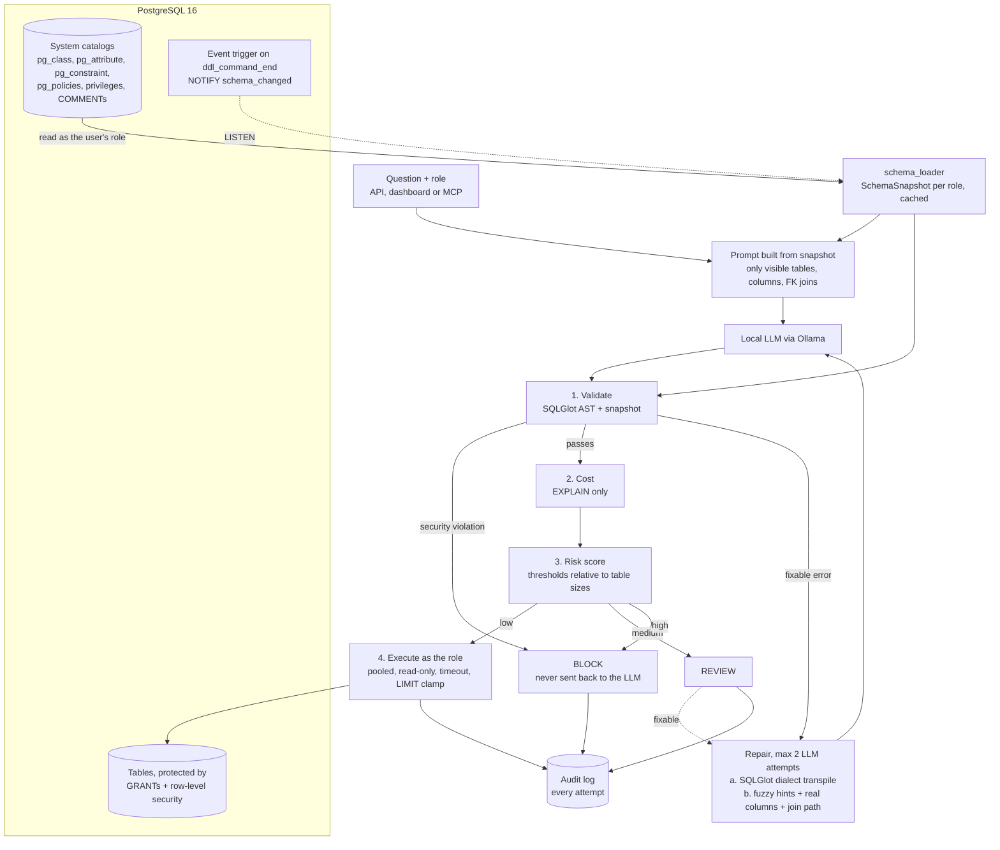

# Risk-Aware LLM-to-SQL Guardrail

A security and performance layer between an LLM and a PostgreSQL database. The LLM (a local
Ollama model) writes SQL; the guardrail validates it, estimates its cost, scores the risk and
then **ALLOWs**, sends to **REVIEW** or **BLOCKs** it. Fixable mistakes are sent back to the LLM
with precise, database-aware feedback.

The guardrail is **dynamic**: it contains no table or column names. It reads what each database
role may see from PostgreSQL's own catalogs, so it works on any PostgreSQL database and changes
its behaviour the moment a GRANT, COMMENT or row-level security policy changes.

## Architecture



## How it stays dynamic

| What the guardrail needs | Where it comes from (no code changes) |
|---|---|
| Tables and columns | `pg_class`, `pg_attribute` |
| What this role may read | `has_column_privilege`, `has_schema_privilege` (table and column GRANTs) |
| Join paths | foreign keys in `pg_constraint` |
| Row filtering | `pg_class.relrowsecurity`, `pg_policies` (enforced by PostgreSQL via `SET ROLE`) |
| Table sizes for cost thresholds | `pg_class.reltuples`, `relpages`, `pg_stat_user_tables` |
| Sensitive columns | column `COMMENT` containing `pii` or `sensitive`, plus a name heuristic |
| When to refresh | event trigger + `LISTEN/NOTIFY`, or `POST /schema/refresh` |

`app/guardrail/policy.py` now holds only generic settings: allowed SQL functions, risk
thresholds and `MAX_LIMIT`.

## Setup

Needs Python 3.12, PostgreSQL 16 and Ollama.

1. Create a virtual environment and install packages:
   - macOS/Linux: `python3.12 -m venv .venv && source .venv/bin/activate`
   - Windows: `python -m venv .venv` then `.\.venv\Scripts\Activate.ps1`
   - `pip install -r requirements.txt`
2. `cp .env.example .env` and set `DB_PASSWORD`, `BENCH_PASSWORD` and `ADMIN_USER`.
   Passwords live only in `.env` (git-ignored), never in the SQL scripts.
3. Create the demo databases (macOS/Linux/Git Bash):
   - `bash scripts/setup_db.sh` (shop database, read-only role, demo roles, event trigger)
   - `bash scripts/setup_college_db.sh` (second, unrelated schema)

   On Windows without bash, run the scripts in `scripts/` in number order with `psql`, e.g.
   `psql -d guardrail_db -v ro_password="..." -f scripts\03_roles.sql`.
4. `ollama pull qwen2.5:3b` (or set `OLLAMA_MODEL` in `.env`).

## Run

- API: `uvicorn app.main:app --reload`
- Dashboard: `streamlit run dashboard/Home.py`
- MCP server: `python -m app.mcp_server`
- Tests: `pytest`

### Roles (multi-user)

Send the database role in the `role` field or the `X-DB-Role` header. The guardrail's login
role switches to it with `SET ROLE`, so PostgreSQL applies that role's GRANTs and RLS.

```bash
curl -X POST localhost:8000/query -H "Content-Type: application/json" -H "X-DB-Role: city_manager" -d '{"sql": "SELECT city, count(*) FROM customers GROUP BY city"}'
```

| Demo role | Sees | Same query `SELECT name, email FROM customers` |
|---|---|---|
| `analyst` | sales data, customers without email/phone | BLOCK (no GRANT on email) |
| `city_manager` | as analyst, but only Hyderabad rows (RLS) | BLOCK |
| `support` | customer contact details, orders without amounts | REVIEW (granted, but PII) |

Other endpoints: `GET /roles`, `GET /schema?role=analyst`, `POST /schema/refresh`, `POST /ask`.

### See it change without code changes

```sql
REVOKE SELECT ON products FROM analyst;                       -- products is now blocked for analyst
COMMENT ON COLUMN orders.total_amount IS 'sensitive: revenue'; -- now goes to REVIEW
```

The event trigger notifies the guardrail, which reloads its snapshot within about a second.

## Point it at any database

1. Create a login role with only the SELECT grants you want (see `scripts/03_roles.sql`), and
   set `DB_NAME`, `DB_USER`, `DB_PASSWORD` in `.env`.
2. Optional: run `scripts/05_schema_events.sql` as a superuser for automatic refresh. Without
   it, snapshots still refresh every 5 minutes or on `POST /schema/refresh`.
3. Optional: mark private columns with `COMMENT ON COLUMN ... IS 'PII: ...'`.
4. Optional: for several users, create roles and `GRANT role TO <login role> WITH INHERIT FALSE, SET TRUE`.

That is all. `DB_NAME=college_db uvicorn app.main:app` runs the same code on the college schema.

## Use from an AI assistant (MCP)

`app/mcp_server.py` exposes `ask_database(question)`, `run_sql(sql)` and `describe_schema()`.
Every call goes through the guardrail. Example entry for an MCP client config:

```json
{
  "mcpServers": {
    "sql-guardrail": {
      "command": "/path/to/project/.venv/bin/python",
      "args": ["-m", "app.mcp_server"],
      "cwd": "/path/to/project",
      "env": {"GUARDRAIL_ROLE": "analyst"}
    }
  }
}
```

## Evaluate

- `python -m evaluation.run_nl` and `python -m evaluation.run_nl --db college_db`:
  small model alone vs small model + guardrail (+ a larger model if `OLLAMA_LARGE_MODEL` is
  installed). Writes `evaluation/results/bench_<db>_*.csv`, shown on the dashboard page
  "Small model benchmark".
- `python -m evaluation.run_eval`, `run_holdout`, `run_final`: the original labelled SQL sets.

Results with `qwen2.5:3b` (20 answerable + 6 unsafe questions per database):

| Database | Setup | Query ran | Correct | Unsafe requests let through |
|---|---|---|---|---|
| shop | small model alone | 90% | 85% | 3 of 6 |
| shop | + guardrail + repair | 100% | 80% | 0 of 6 |
| college | small model alone | 90% | 70% | 4 of 6 |
| college | + guardrail + repair | 100% | 80% | 0 of 6 |

## Project layout

- `app/guardrail/schema_loader.py`: catalog reader, `SchemaSnapshot`, cache, LISTEN thread
- `app/guardrail/validator.py`, `cost.py`, `risk.py`: the three checking layers
- `app/guardrail/engine.py`: runs the layers and executes with an AST-level LIMIT
- `app/guardrail/llm.py`, `repair.py`, `pipeline.py`: prompt, feedback and repair loop
- `app/guardrail/db.py`: connection pool, `SET ROLE`
- `app/main.py`: FastAPI service; `app/mcp_server.py`: MCP server
- `dashboard/`: Streamlit dashboard
- `scripts/`: schema, seed, roles, demo roles + RLS, event trigger, college database
- `evaluation/`, `tests/`: benchmarks and pytest tests

## Safety properties

- The pooled connection is forced read-only with a statement timeout, whatever the role settings.
- Before a query is ALLOWed, it is only ever sent to PostgreSQL inside `EXPLAIN` (no `ANALYZE`),
  so it is planned but never executed.
- Security violations (forbidden table or column, writes, dangerous functions, `SELECT *` over
  hidden columns) are blocked at once and never sent back to the LLM.
- Prompts and repair hints are built only from columns the role can read.
