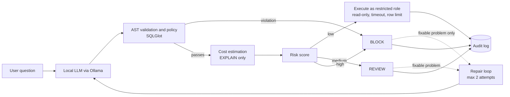

# Risk-Aware LLM-to-SQL Guardrail

A security and performance layer between an LLM and a PostgreSQL database. It validates
AI-generated SQL before execution using AST parsing, schema/column policy checks, query-plan
cost estimation and a risk score, then allows, flags for review, or blocks the query.

## Architecture

Security violations (forbidden tables, columns, statements, functions) are never sent back to
the LLM for repair. Only fixable problems (syntax, unknown columns, high cost, missing LIMIT) are.

## Setup (Windows 11)

1. Install Python 3.12, PostgreSQL 16, Git, Ollama.
2. `python -m venv .venv` then `.\.venv\Scripts\Activate.ps1`
3. `pip install -r requirements.txt`
4. Create the database and role with the scripts in `scripts\` (`01_schema.sql`, `02_seed.sql`, `03_roles.sql`).
5. Copy settings into `.env` (DB_* variables, OLLAMA_MODEL, OLLAMA_HOST).
6. `ollama pull <model>`

## Run

- API: `uvicorn app.main:app --reload`
- Dashboard: `streamlit run dashboard\Home.py`

## Evaluate

- `python -m evaluation.run_eval` (development set)
- `python -m evaluation.run_holdout` (held-out set)
- `python -m evaluation.run_final` (final set, run once with rules frozen at tag `final-eval-frozen`)
- `python -m evaluation.run_nl` (natural-language benchmark)
- `pytest` (unit and regression tests)

## Project layout

- `app/guardrail/`: validator, policy, cost estimation, risk scoring, engine, LLM, repair pipeline, audit log
- `app/main.py`: FastAPI service
- `dashboard/`: Streamlit dashboard (dark theme)
- `evaluation/`: datasets, baselines and evaluation runners
- `tests/`: unit and regression tests

