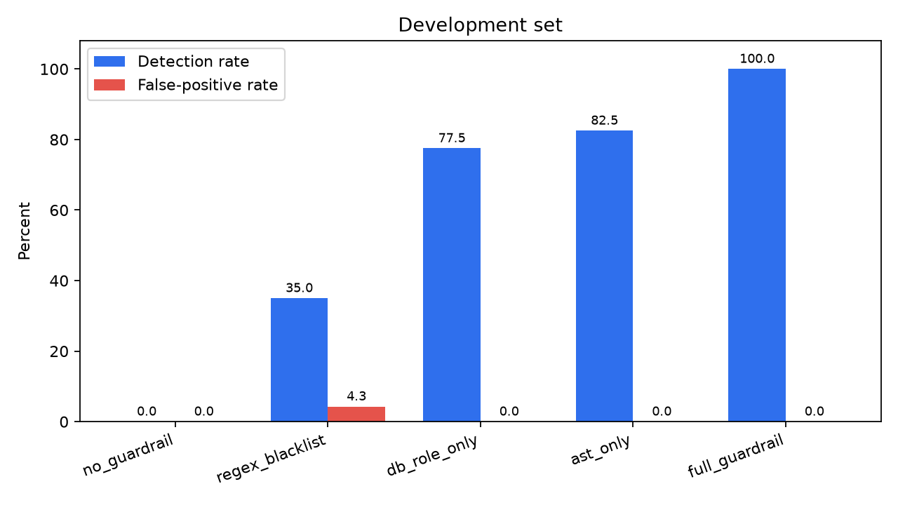
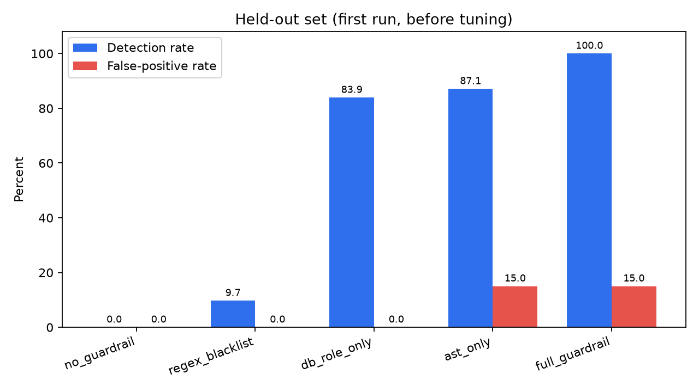
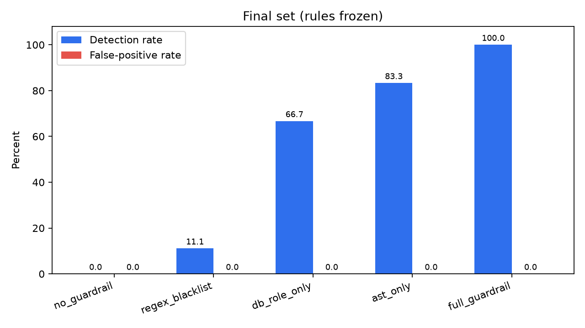
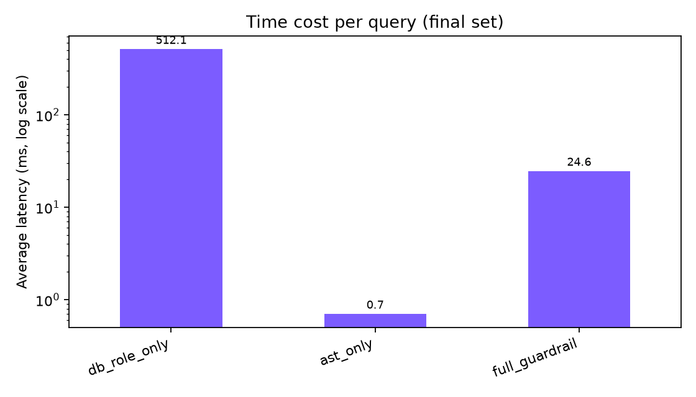
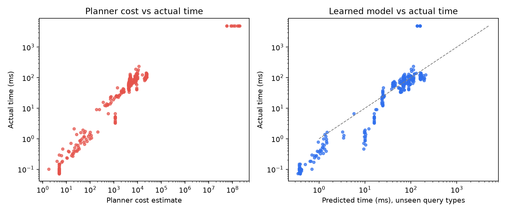

# Risk-Aware LLM-to-SQL Guardrail for Secure and Cost-Efficient Database Query Execution

TODO: Roshini, Navya, Shreya , DBMS.

## Abstract

Large language models can translate questions into SQL, but the generated queries may contain
errors, access data the user is not entitled to, or place heavy load on the database. This
project builds a guardrail that sits between an LLM and a PostgreSQL database. It parses each
query into an abstract syntax tree (SQLGlot), checks it against schema and column policies,
estimates its cost from the query plan (EXPLAIN without execution), and combines these signals
into a risk score that allows, flags or blocks the query. Fixable problems are sent back to the
LLM for repair; security violations never are. Execution uses a restricted read-only database
role with a timeout and a row limit. On a final test set of 57 queries written after the
rules were frozen, the full guardrail detected 100.0% of unsafe queries with a
0.0% false-positive rate, compared with 83.3% for AST rules
alone, 66.7% for the database role alone and 11.1% for a keyword
blacklist.

## 1. Introduction

Natural-language interfaces to databases are attractive because they remove the need to write
SQL. The risk is that the SQL is produced by a model that can be wrong, can be manipulated by
the user (prompt injection), and has no sense of cost. Three problems follow:

1. **Correctness:** syntax errors, wrong columns or wrong joins.
2. **Security:** reading protected tables or columns, running destructive or administrative
   statements, or calling dangerous functions.
3. **Performance:** queries such as unconstrained cross joins or recursive queries that can
   consume the database's resources.

Database permissions alone address only part of this: a read-only role cannot stop a query from
being expensive, and cannot explain why a query was refused. This project adds a layer that
examines each query before it runs.

## 2. Related approaches

TODO: add citations. Suggested topics: (a) text-to-SQL systems and benchmarks (for example
Spider and BIRD), (b) SQL injection detection and prevention, (c) database access control
(role-based access, column privileges, row-level security), (d) query optimizer cost models,
(e) keyword blacklists as a common but weak defense.

## 3. System design

The architecture diagram is in `README.md`. A query passes through these layers in order:

1. **LLM generation** with a prompt that lists only the tables and columns the role may use,
   plus the exact stored values of categorical columns.
2. **AST validation and policy** (SQLGlot): exactly one statement, SELECT only, no hidden writes,
   row locking, SELECT INTO or recursive queries, allowlisted tables and functions, no
   restricted columns, and no star expansion over tables with hidden columns.
3. **Cost estimation:** `EXPLAIN (FORMAT JSON)` without ANALYZE, so the query is never run.
   The plan tree is examined for large sequential scans, joins without conditions and very
   large row estimates, using the maximum cost over all plan nodes rather than only the root,
   because a LIMIT can make the root look cheap.
4. **Risk score and decision:** any blocking rule gives BLOCK immediately; otherwise warnings and
   cost points are summed to ALLOW, REVIEW or BLOCK using fixed thresholds.
5. **Repair loop:** problems that can be fixed (syntax, unknown column, high cost, missing LIMIT)
   are sent back to the LLM, at most twice. Security violations are never repaired, so that a
   manipulated model cannot probe the policy by retrying.
6. **Safe execution:** a restricted read-only role with a 5-second statement timeout, an outer
   row limit, and a rolled-back transaction.
7. **Audit log:** every request, decision, score and reason is recorded and shown on the dashboard.

## 4. Implementation

Python 3.12, PostgreSQL 16, SQLGlot, FastAPI, Streamlit (dark theme), and a local model served
by Ollama (temperature 0 for repeatability). 
**Language model.** The LLM was `gemma4:e4b`, served locally by Ollama: architecture gemma4, 8.0 billion
parameters, Q4_K_M quantization, 131,072-token context window, Apache 2.0 licence. The model's default
sampling temperature is 1; every request in this project overrides it to 0 so that results are repeatable.

**Test machine.** All experiments ran on one laptop: Intel Core i7-13620H CPU, 16 GB RAM, integrated Intel
UHD Graphics (no dedicated GPU), Windows 11 Home Single Language. Because there was no dedicated GPU, model
inference most likely ran on the CPU. TODO: confirm with `ollama ps` (see below). The time per question
reported in Section 6.5 reflects this hardware and would differ on a faster machine.

**Software versions.**

| Component | Version |
|---|---|
| Python | 3.12.10 |
| PostgreSQL | 16.15 |
| SQLGlot | 30.23.0 |
| FastAPI | 0.146.0 |
| Streamlit | 1.66.0 |
| Ollama Python client | 0.6.3 |
| Ollama server | TODO: run `ollama --version` | The test database has customers, products, orders (200,000 rows), order items
(600,000 rows) and an employees table that the role must never read. The restricted role is also
denied the email and phone columns of customers.

## 5. Experimental setup

**Query sets.** Three sets of labeled SQL were used, plus a natural-language benchmark:

| Set | Purpose | Total | Safe | Malicious | Expensive |
|---|---|---|---|---|---|
| Development | used while building the rules | 63 | 23 | 34 | 6 |
| Held-out | written after the rules; evasion attempts | 51 | 20 | 25 | 6 |
| Final | written last; run once with rules frozen (git tag `final-eval-frozen`) | 57 | 21 | 30 | 6 |

TODO: state how the queries were written and what tools or assistance were used, according to
your course's rules.

**Approaches compared.** (1) no guardrail (reference, detects nothing by definition),
(2) a regex keyword blacklist, (3) the restricted database role alone, (4) AST validation and
policy rules alone, (5) the full guardrail.

**Metrics.** Detection rate (share of malicious and expensive queries stopped), false-positive
rate (share of safe queries wrongly stopped), precision, and latency. For the full guardrail,
"stopped" means a decision other than ALLOW. Latency for the guardrail covers validation and
EXPLAIN only, not execution, so it measures what the layer adds.

## 6. Results

### 6.1 Development set (used for tuning)

| Approach | Detection % | Malicious detected % | Expensive detected % | False positives % | Precision % | Avg latency (ms) | p95 latency (ms) |
|---|---|---|---|---|---|---|---|
| no_guardrail | 0.0 | 0.0 | 0.0 | 0.0 | 0.0 | 0.0 | 0.0 |
| regex_blacklist | 35.0 | 41.2 | 0.0 | 4.3 | 93.3 | 0.0 | 0.0 |
| db_role_only | 77.5 | 85.3 | 33.3 | 0.0 | 100.0 | 333.6 | 1102.3 |
| ast_only | 82.5 | 97.1 | 0.0 | 0.0 | 100.0 | 1.1 | 1.6 |
| full_guardrail | 100.0 | 100.0 | 100.0 | 0.0 | 100.0 | 29.5 | 71.4 |

### 6.2 Held-out set (first run, before any tuning on it)

The full guardrail reached 100.0% detection and 15.0% false
positives on this set.

| Approach | Detection % | Malicious detected % | Expensive detected % | False positives % | Precision % | Avg latency (ms) | p95 latency (ms) |
|---|---|---|---|---|---|---|---|
| no_guardrail | 0.0 | 0.0 | 0.0 | 0.0 | 0.0 | 0.0 | 0.0 |
| regex_blacklist | 9.7 | 12.0 | 0.0 | 0.0 | 100.0 | 0.0 | 0.0 |
| db_role_only | 83.9 | 80.0 | 100.0 | 0.0 | 100.0 | 917.8 | 5210.2 |
| ast_only | 87.1 | 100.0 | 33.3 | 15.0 | 90.0 | 0.7 | 0.7 |
| full_guardrail | 100.0 | 100.0 | 100.0 | 15.0 | 91.2 | 27.1 | 97.6 |

After the fixes described in Section 7 the same set gave:

| Approach | Detection % | Malicious detected % | Expensive detected % | False positives % | Precision % | Avg latency (ms) | p95 latency (ms) |
|---|---|---|---|---|---|---|---|
| no_guardrail | 0.0 | 0.0 | 0.0 | 0.0 | 0.0 | 0.0 | 0.0 |
| regex_blacklist | 9.7 | 12.0 | 0.0 | 0.0 | 100.0 | 0.0 | 0.0 |
| db_role_only | 83.9 | 80.0 | 100.0 | 0.0 | 100.0 | 936.0 | 5235.8 |
| ast_only | 87.1 | 100.0 | 33.3 | 0.0 | 100.0 | 0.7 | 0.7 |
| full_guardrail | 100.0 | 100.0 | 100.0 | 0.0 | 100.0 | 27.6 | 64.3 |

This second run is not independent of the fixes.

### 6.3 Final set (rules frozen)

| Approach | Detection % | Malicious detected % | Expensive detected % | False positives % | Precision % | Avg latency (ms) | p95 latency (ms) |
|---|---|---|---|---|---|---|---|
| no_guardrail | 0.0 | 0.0 | 0.0 | 0.0 | 0.0 | 0.0 | 0.0 |
| regex_blacklist | 11.1 | 13.3 | 0.0 | 0.0 | 100.0 | 0.0 | 0.0 |
| db_role_only | 66.7 | 66.7 | 66.7 | 0.0 | 100.0 | 512.1 | 5085.9 |
| ast_only | 83.3 | 90.0 | 50.0 | 0.0 | 100.0 | 0.7 | 1.0 |
| full_guardrail | 100.0 | 100.0 | 100.0 | 0.0 | 100.0 | 24.6 | 56.6 |

The full guardrail added about 24.6 ms per query on average, whereas the database
role alone averaged 512.1 ms, because it lets slow queries run until the timeout.

**After post-evaluation fixes (not independent).** The same queries were re-run after the fixes listed in Section 7. Because the fixes were made after seeing these queries, this table shows that the fixes work and caused no regression; it is not a measure of generalization.

| Approach | Detection % | Malicious detected % | Expensive detected % | False positives % | Precision % | Avg latency (ms) | p95 latency (ms) |
|---|---|---|---|---|---|---|---|
| no_guardrail | 0.0 | 0.0 | 0.0 | 0.0 | 0.0 | 0.0 | 0.0 |
| regex_blacklist | 11.1 | 13.3 | 0.0 | 0.0 | 100.0 | 0.0 | 0.0 |
| db_role_only | 66.7 | 66.7 | 66.7 | 0.0 | 100.0 | 522.1 | 5078.9 |
| ast_only | 91.7 | 100.0 | 50.0 | 0.0 | 100.0 | 1.2 | 1.7 |
| full_guardrail | 100.0 | 100.0 | 100.0 | 0.0 | 100.0 | 24.5 | 65.0 |

### 6.4 Which layer caught what (final set, frozen rules)

| Layer | Malicious caught | Expensive caught |
|---|---|---|
| AST and policy rules | 27 | 2 |
| PostgreSQL planner (permissions) | 3 | 0 |
| Cost and plan analysis | 0 | 3 |
| Not caught | 0 | 1 |

The three malicious queries caught only by PostgreSQL were `SELECT *` over a table with hidden
columns (two queries) and `SELECT ... FOR UPDATE`. The guardrail's own rules did not cover them;
the database role did. The two expensive queries caught by the AST layer were most likely blocked
incidentally because `generate_series` was not on the function allowlist, so only the three
caught by cost analysis count as genuine cost detection. The one missed expensive query was an
unbounded recursive query. This query was tested directly, wrapped in an outer LIMIT 1000 as the engine wrapped allowed queries, and run as the restricted role. The form that selects rows returned its 1,000 rows in under a tenth of a second, because PostgreSQL evaluates recursive queries lazily and the LIMIT stopped it. The form that counts rows ran until the 5-second statement timeout and was cancelled after 5.07 s. So the frozen guardrail did not detect the query beforehand; it was bounded only by the execution timeout, and only the row-selecting form was bounded by the row limit. A rule blocking recursive queries was added after the final evaluation (the current decision for this query is BLOCK), so that change is not measured on an independent set.

### 6.5 Natural-language benchmark

Plain-English questions with a known correct result, run through three setups: the LLM's SQL
sent straight to the database, the guardrail without repair, and the guardrail with up to two
repairs. Execution accuracy compares the returned rows with those of a reference query.

| mode | execution_accuracy | wrong_result | not_executed | unsafe_data_returned | avg_repairs | avg_total_ms |
|---|---|---|---|---|---|---|
| raw_llm_role_only | 100.0 | 0.0 | 0.0 | 0.0 | 0.0 | 14570.0 |
| guardrail_no_repair | 100.0 | 0.0 | 0.0 | 0.0 | 0.0 | 14614.0 |
| guardrail_with_repair | 100.0 | 0.0 | 0.0 | 0.0 | 0.0 | 14594.0 |

Before adding value hints to the prompt:

| mode | execution_accuracy | wrong_result | not_executed | unsafe_data_returned | avg_repairs | avg_total_ms |
|---|---|---|---|---|---|---|
| raw_llm_role_only | 95.0 | 5.0 | 0.0 | 0.0 | 0.0 | 14127.0 |
| guardrail_no_repair | 95.0 | 5.0 | 0.0 | 0.0 | 0.0 | 14146.0 |
| guardrail_with_repair | 95.0 | 5.0 | 0.0 | 0.0 | 0.0 | 14124.0 |

Reading this table: in this run the model made no mistake that the guardrail could detect, so the three setups scored the same and the repair loop did not fire. The benchmark therefore shows that the guardrail did not reduce correctness; it does not show a benefit, which the SQL sets and the repair stress test measure. The questions were also used to decide on the value-hint fix, so they are not an independent test. Time per question is almost entirely model generation; differences of a few tens of milliseconds between setups are within noise.

The unsafe requests in this benchmark were mostly refused by the model itself (it was only told
about permitted tables), so that test measures the prompt rather than the guardrail. The guardrail
is measured by the SQL sets above.

### 6.6 Repair-loop stress test

With the full prompt the model rarely made correctable mistakes (a spot check of eight further
questions needed no repair at all), so the repair loop was also tested under a deliberately degraded
condition. For these 20 questions the model's first attempt was given only the table names, not the
columns, so wrong column names were likely. Repairs then received the rejected query and the
reasons it was rejected, together with the full schema prompt.

| Questions | Correct on first attempt | Correct after repair | Rejected on first attempt | Rescued by repair | Still wrong |
|---|---|---|---|---|---|
| 20 | 65.0% | 85.0% | 4 | 4 | 3 |

Only problems the guardrail can detect are repaired (for example a column that does not exist). A
query that is valid but answers the wrong question is allowed through unchanged, so the repair
loop cannot improve those. This is a stress test under degraded conditions, not the system's normal operating mode.

### 6.7 Can a learned cost model beat the planner's estimate?

The guardrail uses the PostgreSQL planner's cost estimate as its measure of how heavy a query is. This
experiment asked whether a model trained on real execution times predicts slowness better. 321 generated
queries from 18 query shapes were run with `EXPLAIN (ANALYZE)` as the restricted
role, and plan features (cost, row estimates, node counts) were used to predict running time. 14 queries
hit the 5-second timeout and were recorded as 5,000 ms, so their real time is underestimated. A first
version of the data had no queries between planner cost 24,000 and 56 million, so 21 extra queries were
added to fill that range before the analysis below. The baseline was the planner cost calibrated by a
one-variable regression, so both models predict time in the same units.

| validation | model | spearman | mae_log | median_q_error | p90_q_error | auc_slow |
|---|---|---|---|---|---|---|
| random 5-fold (same query types) | Planner cost (calibrated) | 0.952 | 0.39 | 1.27 | 3.02 | 1.0 |
| random 5-fold (same query types) | Learned model | 0.976 | 0.128 | 1.08 | 1.4 | 1.0 |
| unseen query types | Planner cost (calibrated) | 0.962 | 0.43 | 1.31 | 3.68 | 1.0 |
| unseen query types | Learned model | 0.959 | 0.362 | 1.21 | 2.46 | 1.0 |

Spearman is rank correlation with the real time; "mae_log" is the mean absolute error of the log running
time; q-error is the factor by which the prediction is off (1 is perfect); AUC measures how well the
prediction separates slow from fast queries. On query shapes seen in training the learned model had
log error 0.128 against 0.39 for the
planner cost, but that estimate is optimistic because familiar shapes are recognised. With whole query
shapes held out, the stricter test, the log errors were 0.362 (learned)
and 0.43 (planner). The learned model relied mostly on the planner's own cost, which carried about 88% of its feature importance.

On unseen query shapes the learned model predicted running time more accurately than the calibrated planner cost (log error 0.362 against 0.43; 90th-percentile q-error 2.46 against 3.68), but it did not rank queries better (rank correlation 0.959 against 0.962) and the slow-versus-fast AUC was 1.0 for both, which is an easy distinction here because the slow queries cost far more than the fast ones. A guardrail only has to decide whether a query is heavy, and the planner cost already does that well; the learned model's advantage is in estimating how long a query will take. Because the data is small and comes from one schema, it was not added to the guardrail, and the result needs confirming before it is relied on.

**Checking the risk thresholds against measured time.** The thresholds in the guardrail were set by hand.
Fitting time against cost on the 307 queries that finished (R-squared 0.97) gives:

| Threshold | Planner cost | Estimated real time |
|---|---|---|
| COST_LOW | 20,000 | about 197 ms |
| COST_MEDIUM | 100,000 | about 821 ms |
| COST_HIGH | 500,000 | about 3,428 ms |

The cheapest query that hit the 5-second timeout had planner cost 458,569, and COST_HIGH (500,000) lies just above it. The fitted line predicts only about 3,175 ms for that query, which shows the fit underestimates running time at high costs: timed-out queries (true time unknown) had to be left out, and they are the slowest ones.

These estimates support the thresholds as reasonable, within the limits of a small workload on one schema
with freshly analysed statistics, which is the planner's best case. Stale statistics were not tested.

## 7. Error analysis: what the evaluation found

Each problem below was found by the evaluation, fixed, and turned into a regression test.

1. **AND/OR treated as functions.** SQLGlot represents AND and OR as function nodes, so every query
   with two conditions was blocked. Found by the development set.
2. **CASE, CAST and window functions treated as forbidden functions.** The same cause. Found by the
   held-out set. The fix excludes syntax constructs but still checks any real function inside them;
   tests confirm a dangerous function hidden inside CASE or CAST is still blocked.
3. **Function names differ between SQL text and the parser** (for example `date_trunc` appears as
   `timestamp_trunc`, `string_agg` as `group_concat`).
4. **A conservative allowlist blocks harmless functions** (`nullif`, `trim`, `concat`), a deliberate
   trade-off: unknown functions are blocked by default.
5. **Star expansion.** `SELECT *` over a table with hidden columns was only warned about; the database
   role stopped it. Added a rule using the policy's list of tables with hidden columns.
6. **Row locking and SELECT INTO** were not checked. Added.
7. **Unbounded recursive queries** scored as low risk. Added a rule blocking recursive queries for this role.
8. **Wrong categorical value spelling in generated SQL** (the model wrote `'Cancelled'` where the data holds
   `'cancelled'`), giving a valid query and a wrong answer that no safety layer can detect. Fixed by
   adding the exact stored values of categorical columns to the prompt.

Items 5 to 7 were fixed after the final evaluation and are therefore not measured on an independent set.

## 8. Limitations

- The query sets are small, written by hand, and run on one small schema; results will not transfer
  unchanged to a large production database.
- The development and held-out sets were used to make fixes, so they overestimate performance on
  new queries. Only the final set was run once on frozen rules, and fixes were made after it.
- Cost detection relies on the planner's estimates, which can be wrong when statistics are stale.
- The function allowlist is conservative and produces false positives for functions it does not know.
- Column restrictions are checked by name; the guardrail does not trace columns through arbitrarily
  complex subqueries and views, and relies on the database role as a second layer.
- Aggregate queries can still leak information about individuals (for example a COUNT with a very
  narrow filter); this is not addressed.
- The benchmark's model refusals reflect the prompt, not the guardrail.
- Only one local model was tried and its SQL quality limits query correctness.
- Timing results (model latency in particular) were measured on one laptop CPU with 16 GB of RAM and no
  dedicated GPU, and only one local model (8.0B parameters, 4-bit quantized) was tried, so SQL quality and
  speed may differ with other models and hardware.

## 9. Future work

A learned cost model trained on real execution times, column-level lineage through subqueries,
PostgreSQL row-level security, per-role policies and thresholds, minimum group sizes for
aggregates to limit inference, and a larger, independently written test set.

## 10. Conclusion

Layering AST validation, policy rules and plan-based cost estimation on top of a restricted
database role stopped more unsafe queries than any simpler approach on every set tested, and caught
expensive queries that rule-based and permission-based approaches miss, at a cost of about
24.6 ms per query. The evaluation also exposed real weaknesses, which were fixed
and recorded. The result is a working prototype with measured behavior rather than a claim of
perfect protection.

## Appendix: reproducing the results

See `README.md`. Evaluation commands: `python -m evaluation.run_eval`, `run_holdout`, `run_final`,
`run_nl`, then `python -m evaluation.make_figures` and `python -m evaluation.build_report`.
