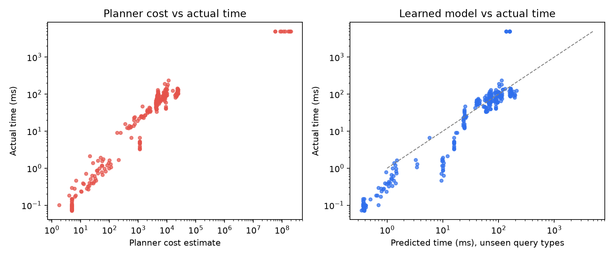

### 6.7 Can a learned cost model beat the planner's estimate?

The guardrail uses the PostgreSQL planner's cost estimate as its measure of how heavy a query is.
This experiment asked whether a model trained on real execution times predicts slowness better.
300 generated queries from 16 query shapes were run through
`EXPLAIN (ANALYZE)` as the restricted role, and plan features (cost, row estimates, node counts) were
used to predict running time. 10 queries hit the 5-second timeout and were recorded as 5,000 ms, so
their real time is underestimated. The baseline was the planner cost calibrated by a one-variable
regression, so that both models predict time in the same units.

| validation | model | spearman | mae_log | median_q_error | p90_q_error | auc_slow |
|---|---|---|---|---|---|---|
| random 5-fold (same query types) | Planner cost (calibrated) | 0.945 | 0.378 | 1.31 | 2.75 | 1.0 |
| random 5-fold (same query types) | Learned model | 0.973 | 0.127 | 1.08 | 1.37 | 1.0 |
| unseen query types | Planner cost (calibrated) | 0.927 | 0.453 | 1.39 | 3.59 | 1.0 |
| unseen query types | Learned model | 0.936 | 0.485 | 1.24 | 3.29 | 0.923 |

Spearman is rank correlation with the real time; "error (log)" is mean absolute error of the log
running time; q-error is the factor by which the prediction is off (1 is perfect); AUC measures how
well the prediction separates slow from fast queries.

On query shapes seen during training, the learned model was clearly more accurate (log error
0.127 against 0.378). This is an optimistic
estimate, because the model can recognise familiar shapes. When whole query shapes were held out, the
stricter test, the results were mixed: rank correlation (0.936 against
0.927) and q-error were slightly better, but log error
(0.485 against 0.453) and the AUC for slow
queries (0.923 against 1.0) were worse.
The learned model's own feature importance was dominated by the planner's cost (about 87%).

Conclusion: on this small workload with freshly analyzed statistics, the planner's cost was already a
reliable signal, and the learned model gave no dependable advantage on unseen query shapes, so it was
not added to the guardrail. The result does not show that learned models cannot help: the planner is
expected to be less reliable when statistics are stale or columns are correlated, which was not tested,
and the data is small and comes from one schema. TODO: re-check this paragraph if the experiment is re-run.

